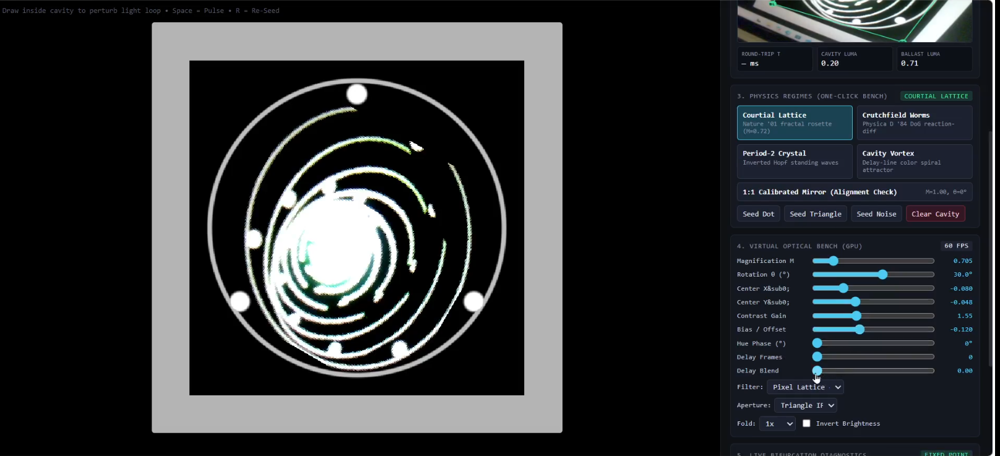

# FunWithOpticalLoops — Optical Cavity Lab (Flicker warning) 



**[Launch Live in Browser (GitHub Pages)](https://anttiluode.github.io/FunWithOpticalLoops/)**

A single-file WebGL optical bench that turns a cheap USB webcam pointed at your monitor into a calibrated physical video-feedback cavity—zero installs, zero build step, runs over HTTPS directly on GitHub Pages.

Instead of fighting a tripod, twisting a camera sideways, and guessing why the loop blew out to white, you leave the webcam stationary and put the optical bench inside a GPU shader: projective homography lock, sub-degree rotation, magnification, 16-frame ring-buffer delay, spatial filters, an auto-exposure ballast border, and live bifurcation diagnostics.

---

## Try It in 30 Seconds

1. **Open the live page:** [`https://anttiluode.github.io/FunWithOpticalLoops/`](https://anttiluode.github.io/FunWithOpticalLoops/)
   * It starts in **Sim Mode** (a virtual lens PSF + sensor pixel-grid + shot-noise loop) so you can click regimes and draw perturbations immediately without a camera.
2. **Switch to real light:**
   * **Desktop + USB webcam:** Point any webcam (cheap 640×480 cameras work great—coarse pixel grids help trigger discrete lattice modes) straight at the left cavity square, dim the room lights, and click **Use Webcam**.
   * **Laptop with built-in camera:** Prop a small mirror in front of the screen so the webcam sees the cavity square.
3. **Lock the geometry:** Frame the entire square inside the **Raw Camera Preview** on the right, then click **Auto-Lock Homography (2s)**. The page flashes a dark frame and 4 corner spots to solve the exact $3 \times 3$ projective transform automatically (you can also drag the 4 green corner handles by hand).
4. **Measure the real loop delay:** Click **Measure τ (ms)** to flash a black-to-white step and time the actual physical photon + USB round-trip latency in milliseconds and display frames.
5. **Disturb the beam:** Click any physics regime, draw inside the cavity with your mouse, or hold a glass of water, magnifying lens, or your fingers between the webcam and monitor.

---

## Built-In Physics Regimes

* **Courtial Lattice** — Nearest-neighbor pixel-grid sampling + triangular IFS boundary aperture ($M = 0.72$, $\theta = 30^\circ$) to drive stationary pixel-feedback rosettes and fractal attractors.
* **Crutchfield Worms** — Difference-of-Gaussians (activator–inhibitor) kernel + 1-frame delay ($M = 1.02$, $\theta = 0.6^\circ$) to generate migrating reaction-diffusion worms and labyrinth domains.
* **Period-2 Crystal** — Brightness-inverted negative feedback + smooth spatial coupling + outer rim boundary ($M = 0.985$) to excite Hopf oscillations and period-doubling standing waves.
* **Cavity Vortex** — 3-frame ring-buffer delay + RGB hue-phase rotation ($M = 0.94$, $\theta = 7.5^\circ$) for swirling color spiral attractors.
* **1:1 Calibrated Mirror** — Unity magnification and zero rotation ($M = 1.00$, $\theta = 0^\circ$) to sanity-check your homography alignment and test whether your camera's auto-exposure is stable.

---

## Dealing With Cheap Webcams (UVC Lock & AE Ballast Border)

Most inexpensive USB webcams aggressively run auto-exposure, which pumps brightness up and down and kills delicate feedback regimes. The lab uses two defenses:

1. **UVC Hardware Lock:** In Chromium browsers (Chrome/Edge), the page queries `MediaTrackConstraints` and attempts to lock exposure, white balance, and focus to `manual`, surfacing a live **UVC Exposure** slider if the driver supports it.
2. **AE Ballast Border:** When a webcam ignores manual lock, the bright/dark frame surrounding the cavity dynamically compensates in real time—brightening as the cavity darkens and dimming as the cavity brightens—to hold total optical flux entering the lens roughly flat. Toggle **AE Ballast Border** on and off in `1:1 Calibrated Mirror` mode to test whether it stabilizes your specific camera.

---

## Live Diagnostics & Controls

* **Space-Time Kymograph ($x$ vs $t$):** Scrolling horizontal center slice showing wave propagation, drift velocity, and standing-wave periods.
* **Poincaré Phase Portrait ($I(t)$ vs $I(t-1)$):** Center-patch return map with an automatic dynamical state readout (`FIXED POINT`, `PERIOD-2 OSCILLATION`, `WAVE / LIMIT CYCLE`, `CHAOTIC / TURBULENT`, `EXTINCT / DARK`, or `SATURATED`).
* **Bench Controls:** Fine sliders for magnification $M$, rotation $\theta$, sub-pixel zoom center $(x_0, y_0)$, contrast gain, bias, hue phase, delay frames/blend, spatial filter (`Linear`, `Pixel Lattice`, `Blur`, `DoG`), persistent aperture mask (`None`, `Outer Rim`, `Triangle IFS`, `Center Post`), and $N$-fold symmetry.
* **Interaction & Export:**
  * Drag with the mouse inside the cavity to paint light perturbations.
  * `Space` injects a center pulse; `R` re-seeds droplets.
  * **Save PNG Snapshot** exports a composite image of the cavity, kymograph, Poincaré portrait, and bench telemetry.
  * **Copy Preset JSON** copies the current bench state and measured $\tau$ to your clipboard.

---

## Run Locally

Browsers restrict `getUserMedia()` on `file://` URLs, so serve the folder locally if you aren't using GitHub Pages:

```bash
python -m http.server 8000
```

Then open http://localhost:8000/ in Chrome or Edge.

Honest Notes
Real cameras vary wildly: Frame latency, rolling shutter, gamma curves, lens distortion, and non-disableable auto-exposure differ across sensors. You will often need to nudge Contrast Gain, Bias, or Ballast Target for your own monitor and room lighting.

Sim Mode is only a fallback: It approximates lens blur, discrete pixel sampling, and shot noise in WebGL so visitors without a rigged camera can explore the interface—it is not a substitute for actual optical feedback.

Background & Prior Art
This bench is an interactive browser implementation inspired by classic physical video-feedback work:

J. P. Crutchfield, "Space-Time Dynamics in Video Feedback", Physica D 10 (1984), 229–245.

J. Courtial, J. Leach, & M. J. Padgett, "Fractals in pixellated video feedback", Nature 414 (2001), 864.

J. De Poorter et al., "Video feedback in the classroom", Physics Education 42 (2007).
